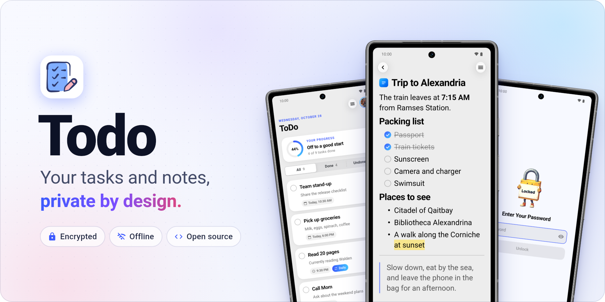
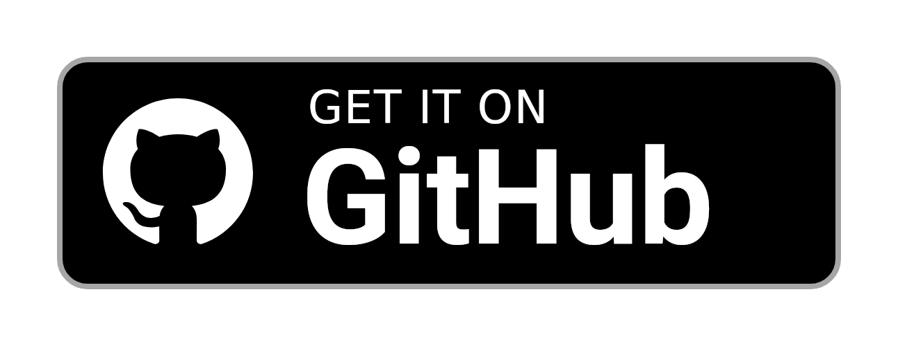
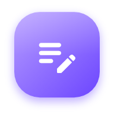
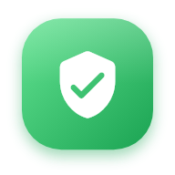

<div align="center">

<picture>
  <source media="(prefers-color-scheme: dark)" srcset=".github/readme/hero-dark.png" />
  
</picture>

<br />
<br />

[](https://f-droid.org/packages/com.k.todo/)
[](https://github.com/KerlosGirgis/Todo/releases/latest)
[](#install)
[](https://flutter.dev)
[](LICENSE)

**A calm to-do list and notebook for Android that keeps everything on your phone.**<br />
No account, no ads, no tracking, and no internet permission.

<a href="https://f-droid.org/packages/com.k.todo/"></a>
<a href="https://github.com/KerlosGirgis/Todo/releases/latest"></a>

</div>

## Features

<table>
  <tr>
    <td align="center" valign="top" width="33%">
      <br />
      <b>Reminders</b><br />
      Get reminded about a task once, or every day.
    </td>
    <td align="center" valign="top" width="33%">
      <br />
      <b>Daily streaks</b><br />
      Daily tasks start fresh each day, with your week and streak on the card.
    </td>
    <td align="center" valign="top" width="33%">
      <br />
      <b>Rich-text notes</b><br />
      Headings, checklists, lists, quotes, code, links, and highlights.
    </td>
  </tr>
  <tr>
    <td align="center" valign="top" width="33%">
      <br />
      <b>Colorful covers</b><br />
      Give each note a color of its own, and its card previews what's inside.
    </td>
    <td align="center" valign="top" width="33%">
      <br />
      <b>App Lock</b><br />
      Lock the app with your fingerprint or a password, and lock any note on its own.
    </td>
    <td align="center" valign="top" width="33%">
      <br />
      <b>Stays on your phone</b><br />
      An encrypted database, encrypted backups, and no internet permission.
    </td>
  </tr>
</table>

## Screenshots

<p align="center">
  
  
  
</p>
<p align="center">
  
  
  
</p>

## Install

Get Todo from **[F-Droid](https://f-droid.org/packages/com.k.todo/)** to stay up to date, or download an APK from **[GitHub Releases](https://github.com/KerlosGirgis/Todo/releases/latest)**:

| APK | For |
| --- | --- |
| `app-arm64-v8a-release.apk` | Most phones |
| `app-armeabi-v7a-release.apk` | Older 32-bit phones |
| `app-x86_64-release.apk` | Emulators and x86 devices |

Todo runs on Android 11 and newer.

## Build from source

You'll need [Flutter](https://docs.flutter.dev/get-started/install) 3.47 or newer, with the Android SDK.

```sh
git clone https://github.com/KerlosGirgis/Todo.git
cd Todo
flutter pub get
flutter run
```

<details>
<summary><b>Signing a release build</b></summary>
<br />

Release builds are signed by the [release workflow](.github/workflows/release.yml) when a version tag is pushed. To sign your own, [make a keystore](https://docs.flutter.dev/deployment/android#sign-the-app), save it as `android/app/kkey.keystore`, and set `ANDROID_KEYSTORE_PASSWORD`, `RELEASE_KEY_ALIAS`, and `ANDROID_KEY_ALIAS_PASSWORD` before you run `flutter build apk --release`.

</details>

## Contributing

Found a bug or have an idea? [Open an issue](https://github.com/KerlosGirgis/Todo/issues). Pull requests are welcome too.

## License

Todo is free software, released under the [GNU General Public License v3.0](LICENSE).

<br />

<p align="center">Developed with ❤️ by <a href="https://github.com/KerlosGirgis">Kerlos Girgis</a></p>
