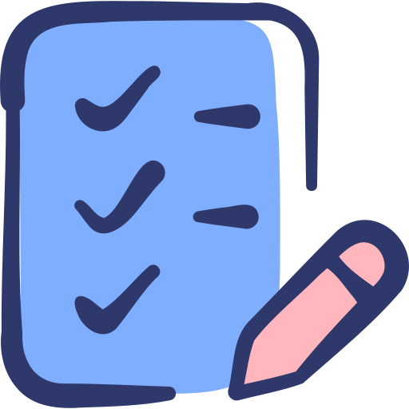
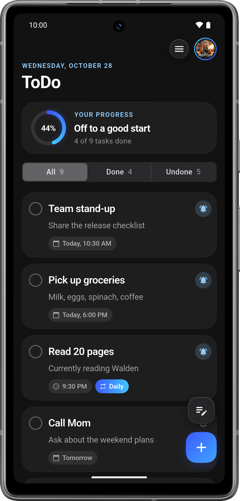
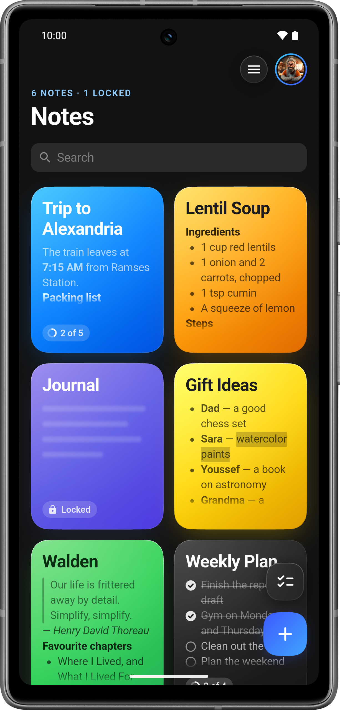
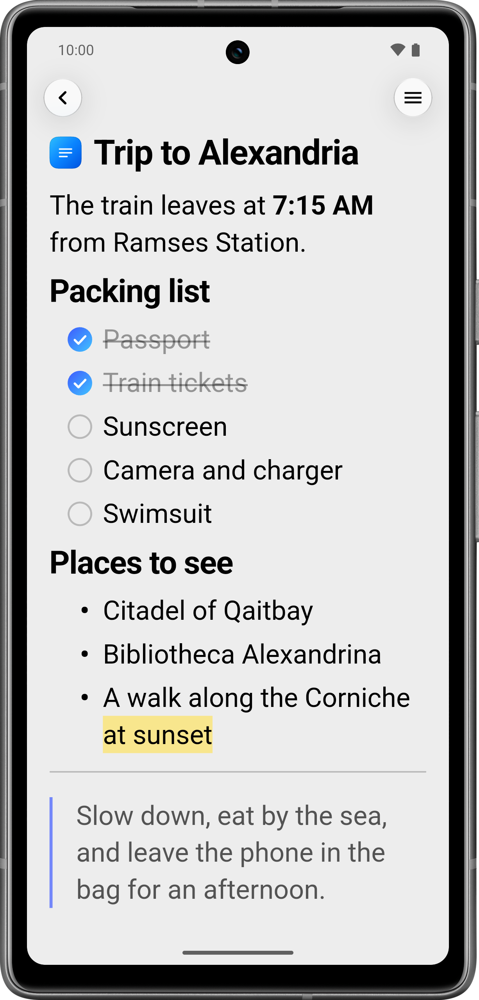
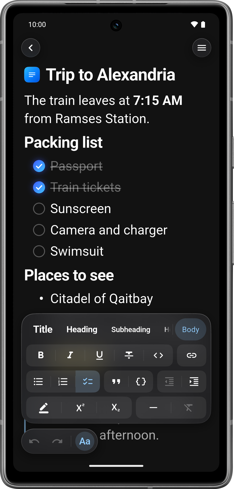
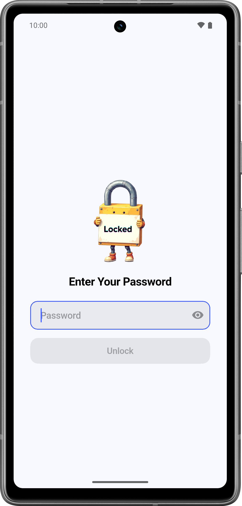
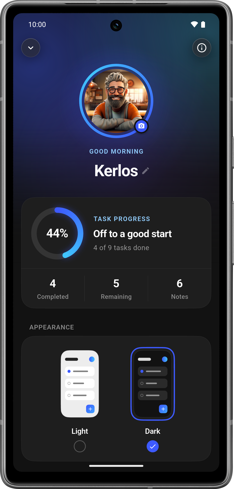
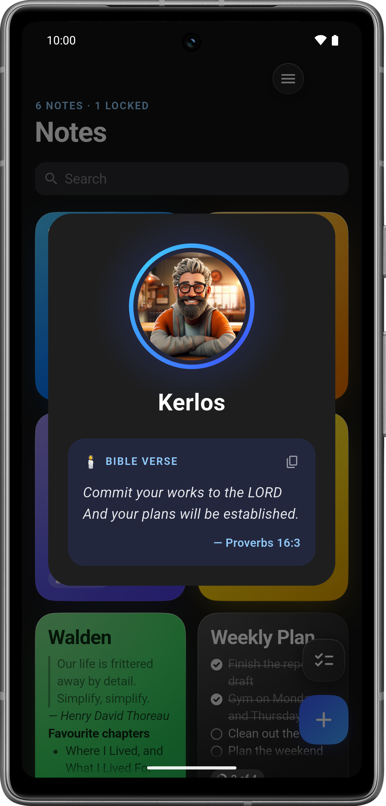
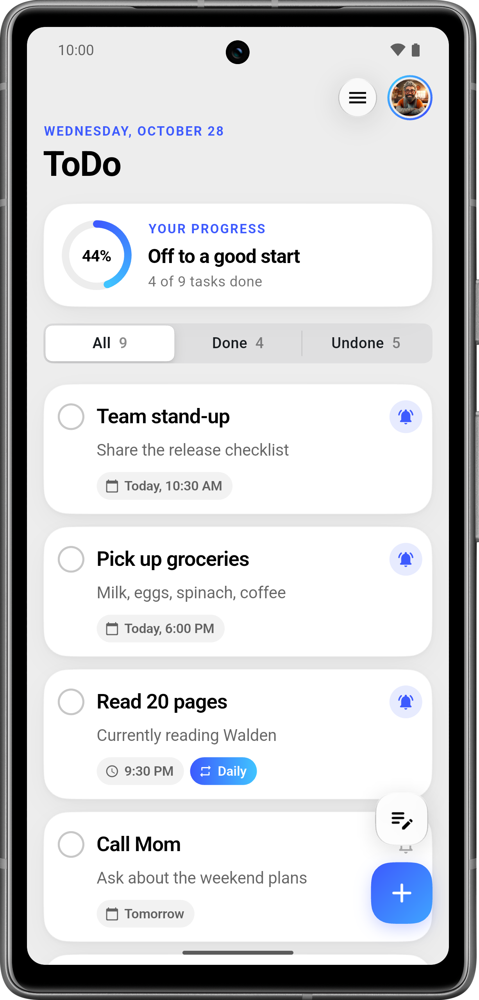

<div align="center">



# Todo

**Your tasks and notes, private by design.**

A calm, simple to-do list and notebook for Android that keeps everything on your phone.<br>
No account, no ads, no tracking, and no internet permission.

[](https://f-droid.org/packages/com.k.todo/)
[](https://github.com/KerlosGirgis/Todo/releases/latest)
[](#install)
[](https://flutter.dev)
[](LICENSE)

<a href="https://f-droid.org/packages/com.k.todo/"></a>

</div>

<p align="center">
  
  
  
  
</p>
<p align="center">
  
  
  
  
</p>

## Features

### ✅ Tasks

- **Reminders.** Give a task a date and a time, and get reminded once or every day.
- **Quick gestures.** Tap a task to check it off, swipe it away to delete it, or press and hold to drag it into place.
- **Your progress at a glance.** A progress ring shows how far along you are, and filters split the list into done and undone.
- **Nothing slips by.** An overdue task's date turns red until it's done.

### 📝 Notes

- **Rich text.** Headings, bold and italic, checklists, bulleted and numbered lists, quotes, code, links, highlights, dividers, and more.
- **Colorful covers.** Give each note its own cover and title color. Cards preview the formatting and show how much of a checklist is done.
- **Find anything.** Search notes by title or by what they say, and arrange them in any order.
- **Write your way.** Notes save as you type. Turn on a live word count, or a relaxed, handwritten font.
- **Home screen widget.** Keep a note on your home screen.

### 🔒 Private and secure

- **Stays on your phone.** Your tasks and notes are kept in an encrypted database. Todo has no internet permission, so your data never leaves your phone unless you export it.
- **App Lock.** Unlock the app with your fingerprint or a password. It locks again after a minute away, and hides its content from the recent apps screen.
- **Locked notes.** Keep individual notes behind your fingerprint.
- **Encrypted backups.** Back up your tasks and notes to password-protected, AES-256 encrypted files, and restore them on any phone.
- **Discreet reminders.** While App Lock is on, reminders don't say which task they're for.

### 🎨 Make it yours

- Light and dark themes.
- One of the built-in avatars, or a photo of your own.
- Open on your tasks or your notes, and choose the text sizes for each.
- A Bible verse for every day, shown when you tap your avatar. You can turn it off.
- A side-by-side layout when you turn your phone sideways.
- Tips that show how each page works, which you can bring back from Settings.

## Install

Get Todo from **[F-Droid](https://f-droid.org/packages/com.k.todo/)** to stay up to date, or download an APK from **[GitHub Releases](https://github.com/KerlosGirgis/Todo/releases/latest)**:

| APK | For |
| --- | --- |
| `app-arm64-v8a-release.apk` | Most phones |
| `app-armeabi-v7a-release.apk` | Older 32-bit phones |
| `app-x86_64-release.apk` | Emulators and x86 devices |

Todo runs on Android 11 and newer.

## Build from source

You'll need [Flutter](https://docs.flutter.dev/get-started/install) 3.47 or newer, with the Android SDK.

```sh
git clone https://github.com/KerlosGirgis/Todo.git
cd Todo
flutter pub get
flutter run
```

Release builds are signed by the [release workflow](.github/workflows/release.yml) when a version tag is pushed. To sign your own, follow Flutter's [signing guide](https://docs.flutter.dev/deployment/android#sign-the-app) and point `signingConfigs.release` in [`android/app/build.gradle`](android/app/build.gradle) at your keystore.

## Contributing

Found a bug or have an idea? [Open an issue](https://github.com/KerlosGirgis/Todo/issues). Pull requests are welcome too.

## License

Todo is free software, released under the [GNU General Public License v3.0](LICENSE).

<br>

<p align="center">Developed with ❤️ by <a href="https://github.com/KerlosGirgis">Kerlos Girgis</a></p>
